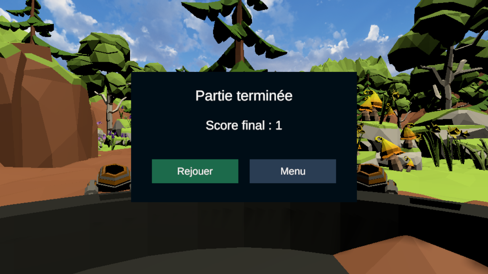

# Fruit Ninja VR — Part 1 : reprise et déploiement multiplateforme

ST2VAAS 2026–2027. Auteurs à confirmer : Fabio Malta, Nicolas Porot, Matéo Biaut, Benjamin Joannard.

**Rapport provisoire : les mesures de builds sont relevées, les tests physiques non réalisés restent explicitement marqués.**

## État initial S7, corrections, organisation retenue

Référence : commit `9313f11`, tag `s7-initial`. Travail sur `Mini-projet-Ben`. Voir [audit](01_etat_initial.md).

Héritage S7 observé : canons fruits/bombes, découpe EzySlice, score/combos/vies, cinq difficultés, sélection par découpe au menu, deux prefabs d'effets communs. Classement, volume réglable et JSON absents des scripts examinés.

Migration 6000.0.58f1 compilée et contrôlée dans l'éditeur. Métadonnées EzySlice restaurées au suivi Git ; assets importés et EzySlice déplacés via AssetDatabase sous ThirdParty, GUID conservés, aucun asset supprimé. Samples et TextMesh Pro conservent leurs chemins hérités. Voir `06_organisation.md`.

Ajouts Part 1 validés et implémentés : menu français plus lisible, score/vies agrandis, animation du score, haptique légère sur coupe, écran de fin avec Rejouer/Menu, volume mémorisé, FPS activable (désactivé par défaut). Tous les objets et références existent dans les scènes/prefabs hors Play. Aucun générateur de scène/UI au lancement ajouté. Le calcul de spawn, découpe, score/combos, vies et difficulté reste hérité ; seule la présentation de fin autorisée remplace le retour immédiat.

[CAPTURE À INSÉRER] ProjectVersion, arborescence Assets et Hierarchy hors Play.

## Les deux effets et leurs variantes PCVR / Quest

Quatre Prefab Variants créés et contrôlés dans l'éditeur, avec PlatformFxSelector sérialisé. Tableau détaillé par système et modules actifs dans `05_effets_plateformes.md`. Les performances sur casque ne sont pas mesurées.

| Variante | Max particles | Lifetime | Start size | Emission | Collision | Matériau / shader | Modules actifs |
|---|---|---|---|---|---|---|---|
| Jus PCVR | 1000 | 0,9 s | 0,1 | Burst 15 | Oui | JuiceMat / Shader Graphs/Juice | Shape, Emission, Size over Lifetime, Trails |
| Jus Quest | 120 | 0,675 s | 0,1 | Burst 1–6 | Non | Identique PCVR | Idem sauf Collision |
| Explosion PCVR (racine/Smoke/Sparks) | 1000 chacun | 0,7/0,7/0,5 s | 3/2/0,05 | Bursts 30/30/20 | Non | ParticlesUnlit / URP Particles Unlit ; SparkMat / URP Lit | Shape, Emission ; Color racine/fumée, Size fumée, Trails étincelles |
| Explosion Quest (racine/Smoke/Sparks) | 80 chacun | 0,525/0,525/0,375 s | 3/2/0,05 | Bursts 1–12/1–12/1–8 | Non | Identiques PCVR | Identiques PCVR |

[CAPTURE À INSÉRER] Quatre prefabs, Inspector et rendu pour chaque plateforme.

Awake choisit Quest dans le player Android et PCVR sous Windows/éditeur, sans créer d'objet. Les canons et EzySlice conservent leurs instanciations dynamiques héritées. Quest réduit particules/durées et la collision du jus ; ces choix visent à réduire le coût, sans gain FPS affirmé avant mesure.

## Configuration des builds, matériel, résultats des tests

Voir [configuration](02_config_builds.md) et [matrice de tests](03_tests_builds.md). Unity : 6000.0.58f1, URP 17.0.4, XRI 3.2.1, OpenXR 1.15.1, XR Management 4.5.2. Migration validée par compilation et tests logiques de l'éditeur ; aucun test casque déduit de ces contrôles.

Matériel PCVR / Quest et réglages : `[À COMPLÉTER]`.

Parcours logique Play Mode réussi : coupe EzySlice avec vitesse injectée, score simple +1, combo de deux +4, bombe −1 vie, fruit manqué sans perte en facile, écran final, Rejouer (score 0/trois vies), Menu, volume modifié puis conservé, FPS activable. Aucun Missing détecté dans les deux scènes et 17 prefabs. Ces contrôles ne valident pas le tracking ni les gestes physiques. Détails dans `03_tests_builds.md`.

Build Windows final reconstruit après les corrections UI/Input Handling : réussi, 0 erreur/0 warning, 1 min 37 s. [TEST NON RÉALISÉ] Exécution avec casque PCVR.

APK final réussi : 0 erreur / 2 recommandations OpenXR (SSAO dans les pipelines configurés, latence d'entrée facultative). IL2CPP, ARM64 uniquement, Linear, min API 24, cible auto résolue à 36. Premier essai annulé pour Input Handling Both non pris en charge ; correction vers Input System uniquement puis tests et build réussis. [TEST NON RÉALISÉ] Installation et exécution Quest autonome.

[CAPTURE À INSÉRER] Build Profiles, Player Settings, Project Validation, rendu des deux plateformes.

## Analyse APK et comparaison tailles / qualité / fluidité

Suivre la [procédure d'analyse](04_analyse_apk.md), puis insérer le tableau produit par `tools/Compare-BuildSizes.ps1`.

| Plateforme | Taille livrable (Mo) | Qualité observée | FPS / méthode / durée |
|---|---|---|---|
| Windows PCVR | Dossier 133,10 Mo ; ZIP 55,28 Mo | [TEST NON RÉALISÉ] | [TEST NON RÉALISÉ] |
| Quest autonome | APK 55,17 Mo | [TEST NON RÉALISÉ] | [TEST NON RÉALISÉ] |

[CAPTURE À INSÉRER] APK Analyzer, contributions principales et Build Report. Expliquer le regroupement des ressources Unity et distinguer tailles compressées/décompressées.

Lecture automatisée du ZIP de l'APK : assets/bin/Data 26,57 / 55,04 Mo (compressé/décompressé), libil2cpp.so 15,37 / 61,65 Mo, libunity.so 9,07 / 20,61 Mo. Les six textures Epic_BlueSunset représentent environ 24 Mo packés Unity. Le total de 821 114 124 octets du Build Report inclut des sources C++ et bibliothèques intermédiaires hors APK ; il n'est pas utilisé comme taille de livraison. Voir `07_contenu_apk.md` et les JSON Build Report.

| Catégorie source (PackedAssetInfo) | Windows (Mo) | Quest (Mo) |
|---|---:|---:|
| Textures | 29,01 | 28,02 |
| Modèles | 3,50 | 3,50 |
| Audio | 0,06 | 0,06 |
| Shaders | 1,82 | 2,97 |

Ces catégories sont calculées par extension source et ne couvrent pas les bibliothèques natives/managed du player complet. Android compile Vulkan et OpenGLES3. Les réglages mobiles hérités (render scale 0,8, ombres 1024) diffèrent du PC (1,0 et 2048), sans conclusion de qualité ou de fluidité au casque avant tests réels.

Livraison : dossier Windows complet et APK sous Livrable, archive commune FruitNinjaVR_Part1.zip. Copie des 184 fichiers Windows et de l'APK vérifiée par SHA256. Builds et Livrable restent hors Git. PC de compilation : i7-9700KF, 15,9 Gio RAM, RTX 2060 ; casque de test à renseigner.

## Difficultés, solutions, limitations

- MCP initial configuré pour un autre projet ; ajout autorisé de `com.unity.pipeline` 1.0.0 afin de connecter l'éditeur du projet.
- Premier import : Unity a annoncé des mises à jour automatiques de AI Navigation, Version Control et Rider ; consigner leur résultat final dans la configuration.
- Le premier APK a été annulé au dialogue Android « Unsupported Input Handling » ; passage de Both à Input System uniquement, vérification des cinq difficultés et du parcours complet, puis compilation APK réussie.
- L'inspection visuelle a révélé un masquage de l'écran final par les sabres/HUD et une mauvaise dimension du slider ; correction dans les prefabs et nouvelles captures éditeur. Une attente de bombe trop courte dans le test a été portée à 30 s sans changer le spawn.
- Le contrôle statique de GUID ne prouve pas l'absence de Missing. Le contrôle éditeur et les tests sur casque sont indispensables.
- Aucune mesure réelle FPS, capture casque ou analyse Android Studio n'est présentée comme effectuée sans preuve.

Voir [actions manuelles](A_FAIRE_MANUELLEMENT.md). Documenter les difficultés supplémentaires et solutions effectivement appliquées.
