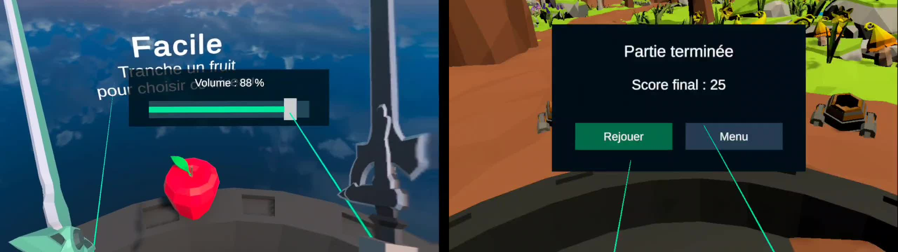
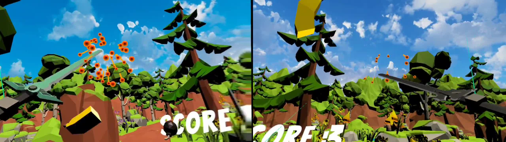
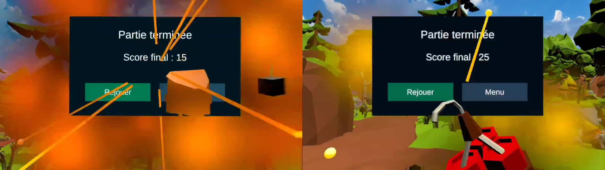

# Fruit Ninja VR — Part 1

**Reprise et déploiement multiplateforme**

**Benjamin JOANNARD** · ST2VAAS — S9 Majeure T2IA · 2026–2027

Projet : [github.com/nicolasPOROT/PRJ-UnityVR](https://github.com/nicolasPOROT/PRJ-UnityVR) — branche `Mini-projet-Ben`.

Cette reprise individuelle s'appuie sur le projet collectif réalisé en S7 en 2025–2026. L'objectif est de conserver une base jouable, organiser les ressources, adapter deux effets et livrer un build Windows PCVR et un APK Meta Quest autonome. Les tests physiques ci-dessous s'appuient sur les vidéos fournies et sur le retour du testeur.

## 1. État initial S7, corrections et organisation — Tasks 1 et 2

| Fonctionnalité / élément initial | État observé | Travail réalisé pour cette Part 1 |
|---|---|---|
| Fruits, bombes, deux sabres, coupe et score | Gameplay opérationnel dans la base S7 | Conservation des règles ; vérification des coupes, du score, des combos et des pénalités |
| Cinq difficultés | Présentes ; fruits manqués sans perte de vie aux niveaux 0–1 | Vérification des cinq niveaux ; règles inchangées |
| Entraînement, bonus, classement et JSON | Aucun mode d'entraînement distinct ni comportement bonus identifié ; classement et sauvegarde JSON absents | Absences consignées ; aucun de ces éléments n'est présenté comme réalisé |
| Effets | Un jus et une explosion communs aux plateformes | Quatre variantes PCVR/Quest et sélection automatique par plateforme |
| Configuration XR | Base OpenXR Windows présente ; configuration Android incomplète | Ajout du provider Android, du support Quest et des profils Touch ; validation sans erreur bloquante |
| Réglage du volume | Absent de la base examinée | Ajout d'un slider VR et mémorisation du volume |
| Fin de partie et lisibilité | Retour immédiat au menu ; affichage perfectible | Écran de fin, score final, boutons Rejouer/Menu et UI plus lisible |

Les ressources importées et EzySlice sont regroupés dans `Assets/ThirdParty`. Les éléments du jeu restent répartis entre `Scenes`, `Scripts`, `Prefabs/Fruits`, `Prefabs/Bombs`, `Prefabs/Fx`, `Prefabs/UI`, `Materials`, `Models` et `Sounds`. Les déplacements ont conservé les GUID et les références. Les actions XRI utilisées restent dans le dossier Samples. L'audit des deux scènes et des 17 prefabs du jeu ne détecte aucun composant ou référence manquants. Une copie initiale est conservée dans Git au tag `s7-initial`.

La séquence de build est **MainMenu (index 0) → PlayScene (index 1)** ; TestScene est exclue. La compilation du projet ne présente pas d'erreur.

Les ajouts personnels comprennent aussi une animation discrète du score, une impulsion haptique à la coupe et un compteur FPS activable pour les tests. Le spawn, EzySlice, les calculs de score/combos, les vies et la difficulté conservent leur logique héritée. Le volume est mémorisé avec PlayerPrefs ; cela ne constitue pas une sauvegarde JSON des scores.

<!-- PAGE BREAK -->

## 2. Deux effets adaptés à PCVR et Quest — Task 3

Une coupe instancie le jus à la position de l'objet tranché ; toucher une bombe déclenche l'explosion et la pénalité. Les quatre Prefab Variants portent les suffixes `_PCVR` et `_Quest`. `PlatformFxSelector` référence les deux variantes dans l'Inspector et choisit Quest dans le player Android, PCVR dans le player Windows. Les prefabs d'origine sont conservés comme bases.

### Coupe de fruit : JuiceFx

| Plateforme | Max particles | Burst | Lifetime | Start size | Collision |
|---|---:|---:|---:|---:|---|
| PCVR | 1 000 | 15 | 0,9 s | 0,1 | Activée |
| Quest | 120 | 1–6 | 0,675 s | 0,1 | Désactivée |

Le matériau **JuiceMat / Shader Graphs/Juice** est conservé. Modules principaux : Shape, Emission, Size over Lifetime et Trails. L'émission continue est nulle : les particules sont émises par burst. La version Quest réduit la densité et la durée, et retire la simulation de collision du jus.

### Bombe : ExplosionFx

| Système | Taille | Max PC / Quest | Burst PC / Quest | Lifetime PC / Quest |
|---|---:|---:|---|---|
| Explosion principale | 3 | 1 000 / 80 | 30 / 1–12 | 0,7 / 0,525 s |
| Fumée | 2 | 1 000 / 80 | 30 / 1–12 | 0,7 / 0,525 s |
| Étincelles | 0,05 | 1 000 / 80 | 20 / 1–8 | 0,5 / 0,375 s |

Explosion et fumée utilisent **ParticlesUnlit / URP Particles Unlit**, les étincelles **SparkMat / URP Lit**. Les collisions sont désactivées sur les trois systèmes. Shape et Emission sont actifs ; Color over Lifetime agit sur l'explosion/fumée, Size over Lifetime sur la fumée, Trails sur les étincelles. Noise et Velocity over Lifetime sont désactivés.

**Adaptation.** Matériaux et tailles restent communs. Quest réduit bursts, plafonds et durées (−25 %) et retire les collisions du jus : le feedback conserve son apparence, avec moins de particules et une persistance plus courte. Les captures proviennent de parties différentes, non synchronisées ; elles n'établissent aucun gain FPS.

<!-- PAGE BREAK -->

## 3. Configuration et tests des deux builds — Task 4

**Environnement logiciel :** Unity 6000.0.58f1, URP 17.0.4, XR Interaction Toolkit 3.2.1, OpenXR 1.15.1, XR Management 4.5.2, EzySlice.

| Paramètre | Windows PCVR | Meta Quest autonome |
|---|---|---|
| Casque testé | Meta Quest 3 | Meta Quest 3 |
| Exécution | Player Windows sur PC ; liaison Virtual Desktop | APK installé et exécuté sur le casque, confirmé par le testeur |
| Cible / backend | Windows x64 / Mono | Android / IL2CPP / ARM64 uniquement |
| XR | OpenXR, profils Oculus Touch / Quest Touch | OpenXR, Meta Quest Support et profils Touch |
| Qualité URP | PC : render scale 1, ombres 2048 | Mobile : render scale 0,8, ombres 1024 |
| Autres réglages graphiques | Linear, HDR actif, MSAA désactivé | Linear, HDR actif, MSAA désactivé ; Vulkan puis OpenGLES3 |
| API Android | Sans objet | Minimum 24 ; cible et compilation 36 |
| Build final | Réussi : 0 erreur, 0 warning | Réussi : 0 erreur, 2 recommandations OpenXR non bloquantes |

Les scènes sont identiques et les variantes d'effets diffèrent selon la plateforme. SDK/NDK/OpenJDK sont installés pour cette version d'Unity. L'identifiant Android est `fr.st2vaas.fruitninjavr.ben` (version 0.1.0). Les recommandations OpenXR concernent le SSAO des pipelines configurés et une option de latence d'entrée ; le renderer mobile n'a pas de Renderer Feature SSAO.

Le PC de compilation relevé est un **Intel i7-9700KF, 15,9 Gio de RAM et RTX 2060**. La correspondance exacte avec le poste de test PCVR, le runtime OpenXR Windows actif et les réglages Virtual Desktop (résolution, fréquence, débit) ne sont pas consignés. Ils ne sont pas remplacés par des valeurs supposées.

### Résultats des essais physiques

Vidéos examinées : **PCVR, 86,21 s**, et **APK Quest, 74,97 s**. Elles montrent le jeu déjà ouvert : le démarrage initial et l'installation autonome sont confirmés par le testeur, pas filmés intégralement.

| Vérification | PCVR | Quest autonome | Élément de preuve |
|---|---|---|---|
| Lancement et accès au jeu | Validé | Validé | Retour du testeur ; application en fonctionnement dans les vidéos |
| Suivi et deux sabres utilisables | Observés | Observés | Mouvements du point de vue et des sabres pendant les coupes ; précision/latence non mesurées |
| Fruits, bombes, coupe, score et vies | Observés | Observés | Fruits séparés, progression du score, disparition de vies et fin de partie ; aucun bonus spécifique identifié |
| Jus et explosion | Observés | Observés | Deux effets visibles ; comparaisons de la section 2 |
| Volume par contrôle VR | Validé | Validé | Slider manipulé dans les deux vidéos et confirmation du testeur |
| Écran final et retour au menu | Validés | Validés | Écrans finaux et transitions vers le menu visibles sur les deux vidéos |
| Retour haptique | Confirmé | Confirmé | Sensation validée par le testeur sur les deux builds ; non déductible d'une vidéo |
| Stabilité de la séquence | Aucun crash visible | Aucun crash visible | Observation limitée aux courtes séquences fournies |

Les vérifications complémentaires dans l'éditeur couvrent les cinq difficultés, les règles de perte de vie, les combos et la réinitialisation par Rejouer. Elles complètent les essais physiques sans étendre ce qui est démontré par les vidéos.

**Fluidité : FPS non mesurés.** Les séquences montrent un jeu utilisable, sans blocage repéré ; elles ne permettent pas de mesurer la fréquence réelle du rendu, les frames reprojetées ou la latence. Leur encodage autour de 30 images/s n'est pas une mesure des FPS du jeu. Le sujet rend le relevé chiffré facultatif ; aucune valeur de performance n'est inventée.

<!-- PAGE BREAK -->

## 4. Analyse de l'APK et comparaison des versions — Task 5

L'APK final a été examiné par lecture de sa structure ZIP et par le Build Report Unity. **La manipulation dans Android Studio APK Analyzer et ses captures restent à ajouter pour compléter la procédure demandée dans le sujet.** Les mesures ci-dessous proviennent du fichier réellement produit.

| Entrée / groupe | Mo compressés | Mo décompressés | Rôle |
|---|---:|---:|---|
| assets/bin/Data | 26,57 | 55,04 | Données Unity : scènes, ressources sérialisées, métadonnées et fichiers regroupés |
| lib/arm64-v8a/libil2cpp.so | 15,37 | 61,65 | Bibliothèque native issue du code C# via IL2CPP |
| lib/arm64-v8a/libunity.so | 9,07 | 20,61 | Moteur Unity natif |
| classes.dex | 2,25 | 6,16 | Bytecode Java/Kotlin de la couche Android et de ses dépendances |
| resources.arsc | 0,24 | 0,24 | Table compilée des ressources Android |

Les ressources Unity étant regroupées, un fichier de données ne correspond pas nécessairement à une texture ou un prefab. La lecture du ZIP ne remplace donc pas l'inspection des assets dans le Build Report. Celui-ci attribue environ **29,01 / 28,02 Mo** aux textures Windows/Quest, **3,50 Mo** aux modèles et **0,06 Mo** à l'audio sur chaque plateforme. Les six faces de la skybox Epic_BlueSunset représentent environ **24 Mo packés** et constituent la principale piste d'optimisation des assets. Les shaders représentent 1,82 / 2,97 Mo ; Android embarque les variantes pour deux API graphiques.

### Taille des livrables

| Livrable | Taille en Mo | Taille en octets |
|---|---:|---:|
| APK Quest | 55,17 | 57 851 307 |
| Archive ZIP Windows | 55,28 | 57 963 597 |
| Dossier Windows complet | 133,10 | 139 566 307 |

**Unité : 1 Mo = 1 048 576 octets.** APK et ZIP sont compressés, contrairement à la somme des fichiers du dossier Windows. Leurs tailles proches ne signifient pas un contenu identique : Windows utilise Mono, Quest IL2CPP et des bibliothèques ARM64. Le total brut du Build Report Android inclut aussi des fichiers intermédiaires C++/natifs hors APK ; il n'est pas utilisé comme taille de livraison.

Le gameplay et les UI restent utilisables sur les deux plateformes dans les essais fournis. Les adaptations Quest conservent l'identité des effets tout en réduisant particules, durées et collisions. Les vidéos ne permettent pas d'attribuer une différence de netteté ou de fluidité à ces seuls réglages : capture, compression et streaming PCVR interviennent également. Aucun avantage de performance chiffré n'est revendiqué.

## 5. Difficultés, solutions et limites restantes

- **Déploiement Android :** la configuration héritée Input Handling Both bloquait le build. Le passage à Input System uniquement, déjà utilisé par le rig/UI, a permis de produire l'APK après vérification du gameplay.
- **Interfaces :** lisibilité renforcée et écran final ajouté. HUD et sabres sont masqués en fin de partie ; certains fragments et particules encore actifs peuvent passer brièvement devant le panneau lors de la transition, comme le montrent les vidéos.
- **Effets :** l'adaptation repose sur des variantes distinctes et une sélection par plateforme. Les matériaux restent communs ; les réductions ne constituent pas une preuve de gain FPS sans mesure à conditions identiques.
- **Limites des essais :** pas de mesure de FPS/latence, de session prolongée ou de stabilité thermique ; paramètres de streaming/fréquence non consignés. Le classement, la sauvegarde JSON et les bonus absents de la base ne sont pas présentés comme ajoutés.
- **Avant remise :** joindre les captures d'APK Analyzer, compléter les paramètres de test disponibles et vérifier que la branche du dépôt est publiée et accessible à l'enseignant. Les relevés et captures horodatées sont détaillés dans `docs/preuves/README.md` ; les fichiers de livraison sont regroupés dans `Livrable/FruitNinjaVR_Part1.zip`.
